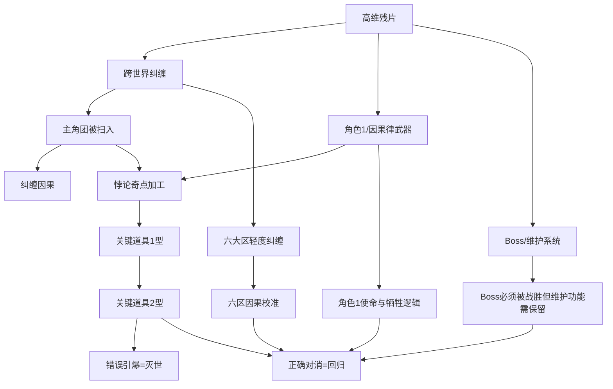

<!-- SECTION-ID: M1-AUTHORING-MYSTERY-GRAPH -->
# Main Mystery Graph — AUTHOR / GM ONLY

主谜题按真相节点与证据依赖组织，不按固定章节顺序组织。节点可从不同 Region、Rule Domain、NPC 或世界事件获得交叉证据。

## Truth Node 模板

```yaml
node_id: mystery-node.<slug>
truth_ref: truth.<slug>
status: OPEN
prerequisites: [] # node_id / 已提交世界状态条件
evidence: [] # clue_id；关键结论至少规划两条可行证据路径
counter_evidence: [] # clue_id
false_hypotheses: [] # hypothesis_id；不得写入 confirmed world truth
reveal_condition: null # 可机器判断的条件草案
related_regions: []
related_rule_domains: []
related_npcs: []
related_events: []
consequence:
  on_reveal: []
  on_misinterpretation: []
  on_delay: []
failure_forward: []
```

## 图约束

- `prerequisites` 形成可检查的有向图；循环依赖必须显式说明解锁机制。
- 关键节点不得只有一次性、单点成功检定作为入口。
- 反证与错误假设是调查对象，不是可以静默投影的真实事实。
- Revelation 只在条件满足并提交 Event 后改变参与者可见知识。
- 节点解锁不强迫 Campaign 按唯一顺序访问 Region。

## 节点索引

该空索引为 `SUPERSEDED_BY_R2` 的 M1 历史容器；当前 ACTIVE 因果图见后续 R2 章节。

<!-- SECTION-ID: R2-AUTHORING-MYSTERY-GRAPH -->
# Main Mystery Graph

## 图结构



## 节点模板

每个Truth Node必须记录：

```yaml
truth_id:
prerequisites: []
evidence_refs: []
counter_evidence_refs: []
false_hypotheses: []
reveal_conditions: []
related_regions: []
related_rule_domains: []
related_npcs: []
consequences:
visibility:
```

## 失败推进

关键Truth Node不能只依赖单次检定。至少提供两类不同来源：

- 世界内证据；
- 实际规则验证；
- 亡者视角；
- 团灭信息；
- 阵营技术；
- 关键道具读取；
- 大区解决结果。

检定影响完整度、风险、时间与代价，不应让主线永久卡死。
